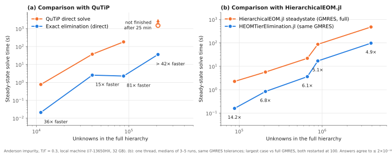

# nonmarkovian-neural-dynamics

Fast, exact steady states for the hierarchical equations of motion (HEOM).

In a truncated HEOM hierarchy, the deepest tier holds most of the auxiliary density operators (ADOs), and at stationarity it can be eliminated **exactly** by a Schur complement. The remaining system is 3.6 to 10.4 times smaller in our benchmarks. This package does that in one call on any QuTiP `HEOMSolver`.

## Install

```bash
pip install "nonmarkovian-neural-dynamics[heom] @ git+https://github.com/HugoWEI/nonmarkovian-neural-dynamics"
```

## Quickstart

```python
from nonmarkovian_neural_dynamics import steady_state

solver = HEOMSolver(H, baths, max_depth=4)       # any QuTiP HEOM solver

rho, ados = steady_state(solver)                  # exact (direct solve of the reduced system)
rho, ados = steady_state(solver, method="gmres")  # matrix-free GMRES, faster for large hierarchies
```

- `rho` is the stationary reduced density matrix (a `Qobj`).
- `ados` is the full stationary hierarchy, ready to use as the initial state of a quench.

[`examples/quickstart.py`](examples/quickstart.py) runs a spinful Anderson impurity and compares the methods with QuTiP:

```
QuTiP steady_state: <n_up> = 0.501962538799   (6.25 s)
elimination, direct: <n_up> = 0.501962538799   (0.46 s)
elimination, gmres : <n_up> = 0.501962538804   (0.37 s)
```

## Julia (HierarchicalEOM.jl)

The same method for HierarchicalEOM.jl models lives in [`julia/HEOMTierElimination`](julia/HEOMTierElimination):

```julia
using HierarchicalEOM, HEOMTierElimination
ados = steadystate_eliminated(M)    # drop-in for steadystate(M)
```

## Results



On a spinful Anderson impurity at T/Γ = 0.3 (laptop, 31.7 GB):

- **vs QuTiP's direct solver:** identical to ≤ 3×10⁻¹³ and up to 160 times faster. A case QuTiP had not finished after 25 minutes takes 36 s.
- **vs HierarchicalEOM.jl's default solver**, same GMRES and tolerances on both sides, timed end to end on one thread (medians of repeated runs): 5.1 to 14.2 times faster at equal accuracy, and 4.9 times faster at 3.9 million unknowns (478 s → 97 s). With multithreaded linear algebra the gains are smaller (2.2 to 4.4).
- **A converged low-temperature reference** for a correlated quench: ⟨n↑⟩(6 ps) = 0.503618 ± 1×10⁻⁵.

Scope: one model, one machine, the Julia package's default solver settings. Bath coefficients were checked one by one against QuTiP (agreement 2.5×10⁻¹⁶). Details, proofs and limitations are in the paper: [`paper/main.pdf`](paper/main.pdf).

## How it works

Write the stationary problem as L y = 0 with y = (x, u), where u is the deepest tier. That tier couples only to the tier above it, so its block D is block diagonal (exactly diagonal for impurity models). Then u = −D⁻¹Cx and

```
(A − B D⁻¹ C) x = 0,   Tr ρ = 1
```

is a smaller system with the same solution. The `gmres` method never builds this matrix; it applies Ax − B(D⁻¹(Cx)) directly, which avoids fill-in. The elimination is exact only for the stationary state: time evolution still needs the full hierarchy.

## Repository

| Path | Contents |
|---|---|
| `src/nonmarkovian_neural_dynamics/tier_elimination.py` | The method and the `steady_state` API |
| `julia/HEOMTierElimination/` | Julia package for HierarchicalEOM.jl models |
| `examples/` | Runnable examples |
| `benchmarks/heom_steady_state/` | QuTiP and HierarchicalEOM.jl benchmarks, raw results, plot |
| `paper/` | Write-up (LaTeX and PDF) |
| `tests/` | Unit tests, including agreement with QuTiP |
| `docs/history.md` | Earlier exploratory phases (neural solvers, negative results) |

Run the tests with `pip install -e ".[heom,dev]" && pytest`.

## Roadmap

1. **Reference:** converged answers where exact HEOM still runs. *Done.*
2. **Speed:** cheaper exact solves. *Done (this package).*
3. **Benchmark:** grade cheaper solvers (shallow hierarchies, few Padé poles, neural networks) against the reference. *Next.*
4. **Scale:** apply what passes where exact HEOM cannot go.

## Citation

If you use this code, please cite the repository and the write-up:

```
H. Wei, Exact deepest-tier elimination for stationary hierarchical equations of motion (2026),
https://github.com/HugoWEI/nonmarkovian-neural-dynamics
```
