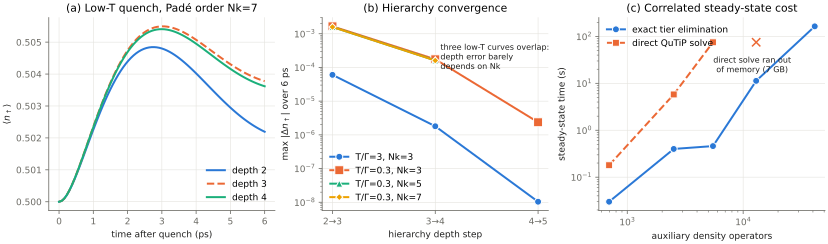

# Exact tier elimination: converged low-temperature reference for the interacting quench

**Date:** November 8, 2026
**Code:** [`tier_elimination.py`](../src/nonmarkovian_neural_dynamics/tier_elimination.py), [`scripts/tier_elimination_convergence.py`](../scripts/tier_elimination_convergence.py), [`scripts/plot_tier_elimination.py`](../scripts/plot_tier_elimination.py), [tests](../tests/test_tier_elimination.py)
**Hardware:** 2 CPU cores, 7 GB RAM (all timings below measured on this machine).



## Summary

The low-temperature interacting benchmark was previously **not converged**: depth 2→3 changed the occupation by 1.6e-3 and the source-order (Nk=7) depth-4 calculation was out of reach. Preparing the correlated stationary hierarchy was the bottleneck (75 s at depth 3; the direct solve ran out of memory at 12,951 ADOs).

Eliminating the deepest hierarchy tier exactly makes that step one to two orders of magnitude cheaper with **no approximation**. This gives, for the first time in this project, a **converged reference**: at T/Γ = 0.3 and source Padé order Nk=7, depth 4 (41,449 ADOs, 663,184 unknowns), ⟨n↑⟩(6 ps) = **0.50362 ± ~1e-5**.

## Method (exact, not new)

HEOM couples each auxiliary density operator (ADO) only to the neighbouring tiers. Write the depth-(n+1) generator with x = tiers 0..n and u = deepest tier:

```
L = [[A, B],
     [C, D]]
```

The deepest tier has no tier below it, so D contains only each ADO's own system Liouvillian and bath decay rates. It is **block diagonal** (one d²×d² block per ADO) — and for this Anderson impurity, whose Hamiltonian is diagonal in the occupation basis, **exactly diagonal** (checked: 79,360 nonzeros on a 79,360-dimensional block, none off-diagonal).

At stationarity C x + D u = 0, hence u = −D⁻¹ C x **exactly**, and

```
(A − B D⁻¹ C) x = 0,   Tr ρ = 1.
```

The full depth-(n+1) stationary hierarchy follows from a depth-n-sized linear solve plus a diagonal division. This is Gaussian elimination (a Schur complement), closely related to HEOM terminator schemes (e.g. Vadimov, SciPost Phys. Core 9, 062 (2026)); **we claim no new theory**. The contribution is the verified application, which unlocks the converged benchmark below. Time evolution after the quench still uses the full hierarchy (the deepest tier carries memory during dynamics).

## 1. Exactness and speed of the stationary state

Compared against QuTiP's `HEOMSolver.steady_state()` on the full hierarchy (μ = 0, U = 1 meV):

| T/Γ | Nk | depth | ADOs | unknowns | direct QuTiP | eliminated | speedup | max \|difference\| (full hierarchy) |
|---:|---:|---:|---:|---:|---:|---:|---:|---:|
| 3.0 | 3 | 3 | 697 | 11,152 | 0.16 s | 0.025 s | 6× | 9.1e-16 |
| 0.3 | 3 | 3 | 697 | 11,152 | 0.18 s | 0.030 s | 6× | 2.2e-14 |
| 0.3 | 3 | 4 | 2,517 | 40,272 | 5.8 s | 0.40 s | 15× | 4.7e-14 |
| 0.3 | 7 | 3 | 5,489 | 87,824 | 75.1 s | 0.46 s | **163×** | 3.4e-13 |
| 0.3 | 5 | 4 | 12,951 | 207,216 | **out of memory** | 11.3 s (~1 GB) | — | residual ‖Ly‖ = 1.2e-15 |
| 0.3 | 7 | 4 | 41,449 | 663,184 | not attempted | 164 s (4.4 GB) | — | residual ‖Ly‖ = 7.3e-15 |

The speedup grows with problem size. Timings include splitting the generator but not building it with QuTiP (needed by both methods, ≤ 5 s).

## 2. Hierarchy-depth convergence of the correlated quench

Each depth starts from **its own fully correlated stationary hierarchy** at μ = 0, then the lead chemical potential is quenched to 0.05 meV; ⟨n↑⟩(t) is evolved for 6 ps (DOP853, rtol 1e-10, atol 1e-12). Values are max |Δ⟨n↑⟩| over the 6 ps between successive depths.

| T/Γ | Nk | 2→3 | 3→4 | 4→5 |
|---:|---:|---:|---:|---:|
| 3.0 | 3 | 6.04e-5 | 1.80e-6 | 1.04e-8 |
| 0.3 | 3 | 1.66e-3 | 1.75e-4 | 2.37e-6 |
| 0.3 | 5 | 1.59e-3 | 1.62e-4 | — |
| 0.3 | 7 | 1.59e-3 | 1.61e-4 | — |

- Earlier repository numbers are reproduced (e.g. 2→3: 6.037e-5 at high T, 1.6578e-3 / 1.5897e-3 / 1.5861e-3 at low T for Nk = 3/5/7; 3→4 at Nk=3: 1.746e-4).
- Convergence is geometric. At low T each extra tier reduces the change by ~10×, then ~70×; at high T by ~30×, then ~170×.
- **The depth error is nearly independent of Nk**, so the Nk=3 depth-5 step (2.4e-6) is a reasonable estimate of the remaining depth error at Nk=7 depth 4.
- All final reduced density matrices are positive (minimum eigenvalue 0.028 at low T) with unit trace; every stationary state has ‖Ly₀‖ ≤ 7.3e-15.

## 3. Padé-order and integrator checks (low T)

| check | max \|Δ⟨n↑⟩\| over 6 ps |
|---|---:|
| Padé Nk 3→5 (depth 4) | **1.57e-3** |
| Padé Nk 5→7 (depth 4) | 5.10e-5 |
| Padé Nk 5→7 (depth 3) | 5.07e-5 |
| Padé Nk 7→9 (depth 3) | 7.44e-6 |
| integrator rtol 1e-10 vs 1e-7 (Nk 7, depth 3) | 3.5e-9 |

**Finding:** at T/Γ = 0.3, Nk = 3 is not adequate. Its Padé error (1.6e-3) is as large as the depth-2 truncation error, so earlier low-T Nk=3 results in this repository are Padé-limited.

## Converged reference

T/Γ = 0.3, Nk = 7, depth 4, μ: 0 → 0.05 meV quench:

- ⟨n↑⟩(6 ps) = **0.503618**
- Estimated error: depth ≈ 2e-6, Padé ≈ 7e-6, time integration < 1e-8 ⇒ **~1e-5 total**, about 160× smaller than the depth-2 truncation error it replaces.

Trajectories: `outputs/tier_elimination_convergence/trajectories.npz` (regenerate with the script; ~6 minutes on 2 cores, peak ~4.5 GB).

## Limitations

- The elimination is exact only for the **stationary** state; post-quench dynamics still need the full hierarchy (29 s at Nk=7 depth 4 here).
- One-lead-per-spin model; this is **not** the two-lead stored initial state of Cao et al.
- The depth-error estimate at Nk=7 uses the Nk=3 depth-5 trend (the depth error is Nk-insensitive, row-by-row above); a direct Nk=7 depth-5 run was not performed.
- Particle–hole symmetry note: when ε − μ = −U/2 the occupation stays exactly 0.5 at every depth (e.g. U=1.1, μ=0.05 in the learned-closure dataset), so such parameter points are trivial test cases.
